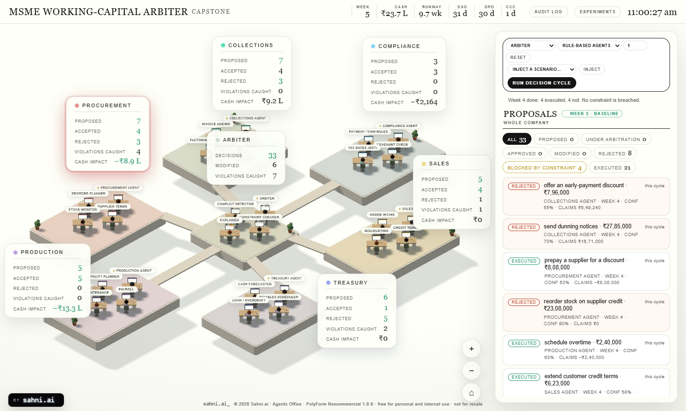

# MSME Working-Capital Arbiter

Semester 7 capstone: **Constraint-Aware Arbitration of Multi-Agent Recommendations for MSME Working-Capital
Decisions: Design, Implementation, and Empirical Audit.**

Six specialist agents (Sales, Procurement/Inventory, Production/Operations, Collections/Receivables,
Treasury, Compliance/Risk) each recommend actions that compete for the same limited cash. A central
**Arbiter**, which is plain deterministic code, keeps the best feasible subset under hard financial
constraints. A seeded simulator and an experiment runner audit it against two baselines. A 3D office is the
front end: you watch the proposals arrive, get arbitrated and execute, and read the audit log.



* The department agents are rule-based proposers. Feasibility and arbitration are decided by the Arbiter, in plain deterministic code.
* Same seed, same result. Every strategy faces the same world for a given seed.
* All money is whole rupees, shown with Indian grouping.

## Run it

Needs Node 20+ (tested on 22) and, for the figures, Python 3 with `numpy` and `matplotlib`.

```bash
npm install
node build.mjs          # bundle the 3D page
npm start               # http://localhost:4520
npm run check           # roster + build + page smoke + a decision cycle over HTTP + unit tests
npm test                # the engine's unit tests only
```

In the page: **RUN DECISION CYCLE** makes the six agents propose, lets the chosen strategy decide, executes the
approved actions and advances one week. **INJECT** adds a shock the agents cannot see coming. **RESET** starts a
new company (strategy, agent type, seed). **G** opens the audit log, **E** the experiments, a click on a pod
filters the proposals to that department.

The project needs no external service, API key or model: the agents are deterministic rules, so every run is free,
instant and reproducible.

## Run the experiments

```bash
# N seeds x scenarios x strategies; writes results/results.csv and results/results.json
node msme/run.mjs --seeds 30
node msme/run.mjs --seeds 5 --scenarios baseline,demand_surge --strategies independent,constraint_aware
node msme/run.mjs --seeds 30 --set objective.w_liquidity=1 --out results/sens   # a sensitivity run

python scripts/plots.py                            # figures -> results/figures, tables -> results/tables.md / .tex
node scripts/sensitivity.mjs                       # the Arbiter's design variants -> docs/sensitivity.md
```

`results.csv` has one row per episode (seed, scenario, strategy) with: constraint-violation rate and its
split by constraint, minimum cash, stock-out units and weeks, cash conversion cycle, ending cash, ending net
worth, operating profit, interest, penalties, proposals approved/modified/rejected. `results.json` adds weekly traces, 95% intervals, paired comparisons and the exact parameters used.
The same run is available from the page (button **EXPERIMENTS**). The 30-seed run reported below, its figures and
tables are in [docs/results](docs/results).

## Architecture

```
  browser: 3D office (src/*.js, three.js)  <--- /api/msme/* --->  serve.mjs (http only, no decisions)
     proposals panel, top-bar books,                                    |
     audit log, experiments                                    msme/session.mjs   (one live company, 3 phases, audit file)
                                                                        |
                    +-----------------------------------------------------------------------------+
                    | msme/episode.mjs  runCycle / runEpisode            msme/run.mjs  experiment runner
                    +-----------------------------------------------------------------------------+
                          |            |              |               |               |
                   agents.mjs     strategies.mjs   constraints.mjs   arbiter.mjs     sim.mjs + actions.mjs + books.mjs
                   rule-based     independent /    check()           objective +     seeded weekly company,
                   proposers      priority_vote /  (5 hard rules)    exact search    scenario injectors
                   schema.mjs     constraint_aware                    audit records
```

One decision cycle, which is also the status flow of the proposals panel:

1. **Proposed.** Each department agent receives the state summary and returns up to three proposals as JSON,
   `{agent, action_type, amount_inr, timing_week, cash_impact_inr, confidence, rationale}`. `schema.mjs`
   validates every field (types, ranges, allowed action types, timing window) and a proposal that fails is dropped
   before it reaches the Arbiter. The agents are not told the hard constraints.
2. **Under arbitration.** The strategy turns proposals into decisions. The Arbiter detects conflicts, searches for the
   best feasible subset (reducing amounts where that helps) and writes an audit record per proposal. A proposal that
   is rejected or cut because of a constraint is shown as **Blocked by constraint**.
3. **Executed.** Approved actions are scheduled into the simulator and the week advances. The real books are then
   checked against the same constraints; that is the *realised* violation the experiment counts.

### The configuration is one file

`msme/config/roster.json` defines the departments, the one agent per department and the lightweight desk
roles (three per department, presentation only). The 3D office, the engine and the checks all read it.
`msme/config/params.json` holds every number the simulator, the constraints and the objective use; the assumptions are
listed in [docs/assumptions.md](docs/assumptions.md).

### The simulator (`msme/sim.mjs`)

A weekly step over cash, receivables with ageing, payables (60% to MSME suppliers), inventory with lead time and a
warehouse limit, overdraft with a limit, payroll, GST and demand with seasonality and noise. Four scenario
injectors: delayed receivable, supplier price spike, demand surge, tightened credit limit. The world's randomness is
drawn once per seed into a noise table, so every strategy meets identical demand, customer delays and breakdowns.
The look-ahead the constraints and the Arbiter use runs the same step in expected-value mode and cannot see a shock
until it has happened.

### The constraints (`msme/constraints.mjs`)

`check(proposal_set, state) -> violations` is a pure function. Five rules, all configurable: minimum cash buffer,
overdraft limit, covenant (current ratio >= 1.33), the 45-day MSME payment term, inventory capacity. It looks four
weeks ahead with the proposals applied. `realizedViolations(state)` applies the same rules to the actual books.

### The Arbiter (`msme/arbiter.mjs`)

Maximises `J(S) = w_profit * sum(confidence * profit) + w_risk * sum(confidence * risk_reduction) + w_liquidity *
min(min_headroom(S), liquidity_target)` over the subsets that violate no constraint. With at most 12 proposals it
evaluates every subset exactly; beyond that it builds greedily. It then refines the amount of each proposal over
{0, 25, 50, 75, 100}%. If a shock has already broken a constraint it picks the set with the smallest total violation. Contradictory pairs
(draw vs repay the overdraft, delay vs settle suppliers, ...) are mutually exclusive. Every decision gets a plain-language
reason generated from the facts of the search (which constraint it would break, which action it contradicts, how much
it would cost the objective). OR-Tools is not used: at this problem size exact enumeration is cheaper and needs no dependency.

### The baselines (`msme/strategies.mjs`)

* **independent**: no arbiter, every proposal executes.
* **priority_vote**: an arbiter with no constraint awareness: ranks by department priority x confidence, drops direct
  contradictions and anything that would overdraw the bank balance by the agents' own figures.
* **constraint_aware**: the Arbiter above.

## Results (30 seeds, 12-week episodes, rule-based agents)

Full tables: [docs/results/tables.md](docs/results/tables.md). Means with 95% intervals; "violation rate" is the share of
weeks in which the real books breach a constraint.

| Scenario | Violation rate: no arbiter | priority vote | **Arbiter** | Operating profit (Rs): no arbiter | **Arbiter** | Stock-out units: no arbiter | **Arbiter** |
|---|---|---|---|---|---|---|---|
| Baseline | 0.64 | 0.73 | **0.03** | 7,87,414 | 5,26,353 | 240 | 798 |
| Delayed receivable | 0.64 | 0.74 | **0.14** | 7,87,760 | 5,24,373 | 240 | 798 |
| Supplier price spike | 0.95 | 0.99 | **0.03** | 7,63,498 | 5,17,140 | 278 | 817 |
| Demand surge | 0.67 | 0.68 | **0.04** | 17,16,293 | 9,59,429 | 796 | 2,358 |
| Credit limit tightened | 0.63 | 0.72 | **0.03** | 7,89,732 | 5,26,353 | 240 | 798 |


What the audit shows, including what does not favour the Arbiter:

1. **The Arbiter nearly eliminates realised violations** in every scenario (paired on the same seeds, lower in 30 of 30
   seeds, intervals exclude zero). Most of the baselines' violations are covenant breaches (about 8 of 12 weeks):
   unconstrained reorders and overdraft draws push the current ratio below 1.33. This is partly true by construction:
   only the Arbiter knows the covenant, and it is the one configuration that is told the rules. The finding is the size of the gap
   and what it costs.
2. **It costs money and service.** Operating profit is about a third lower than with no arbiter (Rs 5.3 lakh
   against Rs 7.9 lakh over twelve weeks in the baseline; lower in 28 of 30 seeds) and stock-outs are about three
   times higher (798 against 240 units; 2,358 against 796 in the demand surge). The Arbiter refuses reorders that
   would breach the covenant or the warehouse limit, and that is lost sales. Ending net worth is not significantly
   different in the baseline (the paired interval includes zero), so the picture is mixed rather than a clean loss.
3. **It is fragile to shocks it cannot forecast.** In *delayed receivable* the Arbiter's violation rate rises from 0.03
   to 0.14 and its mean minimum cash falls to Rs -31,736, no better than the priority vote's Rs 39,591 (the paired
   difference is not significant). It plans up to the buffer on forecast receipts, so when the largest invoice is six
   weeks late there is little left to absorb it. This is the case for a pessimism margin; see the sensitivity study.
4. **The 45-day rule almost never binds** in this model (0.00 to 0.16 weeks per episode for the baselines). In the traces
   inspected the compliance agent settles aged MSME invoices before the limit and the treasury agent's delays mostly
   hit non-MSME invoices. The covenant, the cash buffer and warehouse space do the work.

[docs/sensitivity.md](docs/sensitivity.md) shows how the Arbiter's own design choices move these numbers (30 seeds):

* A **pessimism margin** (assume the largest receivable is paid 2 weeks late) does what the shock calls for: in
  *delayed receivable* the violation rate falls from 0.14 to 0.08 and the mean minimum cash goes from Rs -31,736 to
  Rs 2,98,714. The price is steep: baseline operating profit falls from Rs 5.3 lakh to Rs 0.4 lakh and stock-outs
  more than double (798 to 1,774 units). Protection against a shock that does not happen is paid for every week.
* A **higher liquidity weight and target** (1.0, Rs 10 lakh) gives a smaller version of the same trade: delayed-receivable
  violations 0.14 to 0.09, baseline profit Rs 5.3 lakh to Rs 4.2 lakh.
* Neither variant changes the baseline violation rate (already about 0.03); they move the cost-versus-robustness trade-off,
  not the headline.

### Threats to validity

* The company, the effect of each action and every parameter are modelling assumptions
  ([docs/assumptions.md](docs/assumptions.md)); the results describe this model, not a real firm.
* The department agents are hand-written heuristics, not learned or language-model agents. Other proposers would
  produce different conflicts; the Arbiter and the experiment accept any source of schema-valid proposals.
* The simulator and the constraint layer share their effect models, so the Arbiter's forecast is correct except for the
  shocks and the random demand and payment delays. Real books are not that kind to a forecaster.
* One company, 12-week episodes, 30 seeds per cell; intervals are t-intervals over seeds.

## Components and paper sections

| Paper section | Where |
|---|---|
| **System design**: agents, desks, Arbiter, constraint layer, interfaces | `msme/config/roster.json`, `msme/agents.mjs`, `msme/arbiter.mjs`, `msme/constraints.mjs`, the architecture above |
| Problem model, assumptions | `msme/sim.mjs`, `msme/actions.mjs`, `msme/config/params.json`, [docs/assumptions.md](docs/assumptions.md) |
| Structured proposals and their validation | `msme/schema.mjs`, `test/schema.test.mjs` |
| Objective and search | `msme/arbiter.mjs` (header comment states the objective) |
| **Implementation**: simulator, API, 3D front end, audit log | `msme/session.mjs`, `serve.mjs`, `src/proposals.js`, `src/audit.js`, `data/audit.jsonl` |
| Reproducibility and verification | `test/*.test.mjs` (51 tests), `check.mjs`, seeded noise in `msme/rng.mjs` |
| **Empirical audit**: baselines, metrics, runner | `msme/strategies.mjs`, `msme/episode.mjs`, `msme/run.mjs`, `msme/stats.mjs` |
| Figures and tables | `scripts/plots.py`, [docs/results](docs/results) |
| Sensitivity / ablation | `scripts/sensitivity.mjs`, [docs/sensitivity.md](docs/sensitivity.md) |
| Limitations | the threats to validity above |

## Repository layout

```
msme/            the engine (config/, agents, arbiter, constraints, sim, strategies, runner, session)
src/, build.mjs  the 3D office (three.js, bundled to dist/command-centre-v2.html)
serve.mjs        http server: the page and /api/msme
test/            node:test unit and smoke tests
scripts/         plots.py, sensitivity.mjs
docs/            assumptions, results, sensitivity
data/, results/  generated at run time (git-ignored): audit.jsonl, results.csv / results.json
```

## Attribution and licence

The 3D office front end is derived from **Agents Office by Sahni.ai**, used under its licence (PolyForm Noncommercial
1.0.0 plus Sahni.ai's additional terms, in [LICENSE](LICENSE)). This repository is non-commercial coursework. The roster, simulator, proposal schema, constraint layer, Arbiter,
baselines, experiment runner, audit views and this documentation are new work for the capstone.


## Document Digitizer (Local-Only Integration)

The Document Digitizer parses raw SME bills, invoices (TXT, PDF, PNG/JPEG), and inventory spreadsheets (CSV). It utilizes a 4-step cascade with fuzzy column mapping, GSTIN/tax normalization, and receipt arithmetic verification. Validated documents are staged into SQLite (`data/sme_digitalized_data.db`) and synchronized with the live ledger forward simulation.

> **Note:** The Digitizer is local-only (runs locally via Node `child_process` spawning Python; not on Render / serverless hosting).

### Python Dependencies & Setup

Install the required Python packages for structured table extraction and parsing:

```bash
pip install pydantic python-dateutil
```

For multimodal scanned document & image OCR (optional):

```bash
pip install opencv-python pillow easyocr pytesseract pdf2image
```

Run test verification of the digitizer pipeline:
```bash
python ingestion/digitize_cli.py parse --file data/sample_documents/b2b_purchase_order.txt
python ingestion/digitize_cli.py parse --file data/sample_documents/messy_sme_inventory.csv
```
