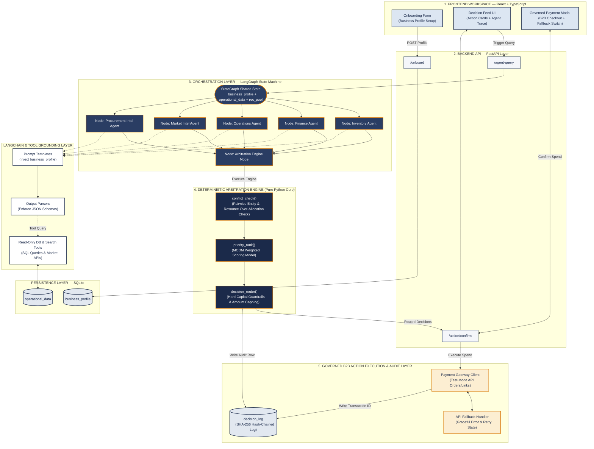

# Master Project Blueprint & 2nd Review Defense Architecture
## Multi-Agent Business Decision Intelligence & Governed B2B Action Execution Platform

---

### Executive Document Summary
This document serves as the **definitive research-grounded master blueprint** for our Capstone Project. It establishes:
1. **Literature Survey & Research Gap Matrix**: Systematic synthesis of 12 peer-reviewed papers (2025–2026) across multi-agent orchestration, financial AI, digital twins, and domain adaptation.
2. **Extended Multi-Agent Architecture**: Domain intelligence spanning **Inventory**, **Finance**, **Operations**, **Market Intelligence**, and **Procurement Intelligence**.
3. **Deterministic Arbitration Engine**: Mathematical Multi-Criteria Decision Making (MCDM) weighted scoring and liquid capital guardrail routing.
4. **Governed B2B Payment Execution Module**: Native financial settlement integration featuring explainable AI metadata, hard spending caps, 1-click human gating, cryptographic SHA-256 audit logging, and graceful API failure handling.
5. **2nd Review Rubric Strategy (Target: 25/25 Full Marks)**: Precise alignment with the evaluation panel's 5 parameters (Literature Survey, Problem Statement, System Design, Implementation/Results >50%, Interim Report).
6. **2nd Review Task Division**: Concrete work allocation across **AryanT**, **Soham**, and **Kohli** to demonstrate a fully integrated >50% working prototype during the panel review.

---

## 1. Literature Survey & Systematic Research Gap Matrix

A comprehensive literature synthesis was conducted across twelve key research papers. The table below documents each study, its core contribution, its specific limitation, and how our project bridges the identified research gaps.

### 1.1 Comprehensive Literature Matrix (Papers 1–12)

| Ref | Study & Publication | Core Technical Contribution | Limitation / Open Research Gap | How Our System Bridges the Gap |
| :--- | :--- | :--- | :--- | :--- |
| **P1** | **Chen et al. (2026)**<br>*Well-log MAS (Elsevier)* | Role-based agent decomposition + tool-grounded hybrid physics/ML reasoning; human-in-the-loop cut error 47% $\rightarrow$ 17%. | Highly single-domain (petroleum well logging) with expert supervision; not generalized to multi-domain business operations. | Adapts role decomposition & read-only tool grounding across 5 business domains (Inventory, Finance, Ops, Market, Procurement). |
| **P2** | **Massoudi & Fuge (2025)**<br>*Agentic LLMs (ASME)* | Multi-agent graph framework out-performed 2-agent setup on coverage, but failed on exact numeric reasoning. | LLM reasoning alone is inherently unreliable for exact numeric/financial math over long context; arithmetic must sit outside LLM. | Enforces strict rule: LLMs generate zero numbers directly; all quantities originate from read-only SQL database tools. |
| **P3** | **Thakker (2026)**<br>*Cloud-Edge MAS (IEEE)* | RL-scheduled hierarchical orchestration; self-healing gives 99.7% completion under network failures. | Validates resilience patterns for cloud-edge infrastructure scheduling, but applied strictly to network traffic, not business decisions. | Borrows self-healing agent state isolation patterns into our LangGraph StateGraph orchestrator. |
| **P4** | **Pendyala et al. (2026)**<br>*AI Payment Orchestration (Springer)* | Identifies fraud, compliance, and routing as fragmented silos; solves with federated learning + blockchain audit. | Blockchain consensus overhead is unjustified at single-SME scale; compliance checks are rule-driven underneath RL routing, not human-approved per action. | Replaces public blockchain with a lightweight, local SHA-256 hash-chained log; introduces 1-click human-gated payment execution. |
| **P5** | **Devi et al. (2026)**<br>*Big Data & Strategic DSS (IEEE)* | Empirically links analytics maturity to enterprise performance across retail, finance, and healthcare. | Confirms the "analytics-to-action gap": systems produce dashboards/reports, but lack mechanisms to convert insights into executable workflows. | Directly replaces chart-based dashboards with a visual **Action Card Feed** with single-tap execution buttons. |
| **P6** | **Khan et al. (2026)**<br>*Agile+TensorFlow DSS (IEEE)* | Delivery methodology for deploying AI-based Decision Support Systems in enterprises using Agile sprints. | Process guidance only; leaves technical multi-agent architecture, conflict resolution, and explainability completely unaddressed. | Provides a concrete, fully specified 5-layer system architecture with code-level schemas. |
| **P7** | **Hasan & Nguyen (2026)**<br>*Agentic AI + Digital Twins (Elsevier)* | Layered *perception $\rightarrow$ reasoning $\rightarrow$ decision $\rightarrow$ action $\rightarrow$ feedback* loop for power-grid balancing. | Assumes a continuous physical digital twin with IoT sensor streams—too heavy and impractical for digital/partially-digital SMEs. | Adapts the closed perception-action loop into a lightweight "Business Context State" built from onboarding profiles and database ledgers. |
| **P8** | **Santhosh et al. (2026)**<br>*BridgeRock AI, Financial MAS (IEEE)* | Multi-agent (Data, Insight, Thesis) + RAG architecture for institutional equity research with evidence pointers. | Output delivered as a conversational chatbot for institutional financial analysts; RAG optimized for unstructured documents, not SQL tables. | Borrows evidence traceability, but replaces document RAG with structured database SQL queries and replaces chat with decision cards. |
| **P9** | **Ma et al. (2026)**<br>*Lightweight Edge MAS (Elsevier)* | Hierarchical edge/cloud tiers; uses game-theoretic (Nash equilibrium) consensus to cut communication overhead. | Game-theoretic consensus is mathematically complex and opaque (black-box) to a non-technical business owner; lacks explainability. | Replaces opaque game-theoretic voting with a transparent, inspectable Multi-Criteria Decision Making (MCDM) weighted score. |
| **P10**| **Electronic Markets (2026)**<br>*MAAI Conceptual Framework* | 5-layer framework (*Foundation Model, Perception, Orchestration, Workflow, Interface*). | Explicitly identifies Dynamic Orchestration (Layer 3) and the User Interaction Layer (Layer 5) as the least studied areas in literature. | Confirms our two core contributions (deterministic conflict arbitration + non-chat decision UI) hit real academic gaps. |
| **P11**| **Kirchdorfer et al. (2025)**<br>*AgentSimulator (Springer)* | Discovers MAS workflows from event logs; demonstrates orchestration vs autonomy must be selected per process. | Coordination rules are discovered post-hoc from historical event logs, rather than arbitrated in real-time for live competing agent outputs. | Validates real-time arbitration of contending agent outputs as an unaddressed operational requirement. |
| **P12**| **Yang et al. (2026)**<br>*SimLoRA (Springer)* | Demonstrates standard LoRA under-learns sparse personalized signals; proposes attention-weighted LoRA + RLHF. | Highlights that domain fine-tuning requires substantial annotation and engineering; unneeded if structured context + tools yield high precision. | Guides our design choice: keep general-purpose LLM + read-only tool grounding as core baseline; treat LoRA fine-tuning as a gated stretch goal. |

---

### 1.2 Extended Agent Intelligence Domains

To provide a comprehensive enterprise management suite, we extend our agent architecture to include **Market Intelligence** and **Procurement Intelligence**.

#### A. Market Intelligence Agent
- **Domain Scope**: Scans external competitor pricing signals, market demand surges, product trend velocity, and macroeconomic consumer sentiment.
- **Existing Solutions & Gaps**: Existing market scrapers (e.g., PriceSpider, SEMrush) operate as isolated marketing tools. They tell a business owner *what* is trending outside, but are completely blind to internal inventory levels or cash reserves. Conversely, internal ERPs are oblivious to external price drops or demand spikes.
- **Our Approach**: Grounded in web-search and price API tools, returning structured `MarketOpportunity` recommendations (e.g. *"Competitor price increased 12%; opportunity to increase retail margin by 5% or scale stock"*). This recommendation is arbitrated against available cash buffer to ensure financial feasibility.

#### B. Procurement Intelligence Agent
- **Domain Scope**: Analyzes supplier lead-time volatility, raw material index pricing, vendor reliability scores, and minimum order quantity (MOQ) volume discounts.
- **Existing Solutions & Gaps**: Standard inventory formulas (EOQ) assume static supplier lead times and fixed unit costs. In reality, supplier lead times fluctuate, and volume discounts require capital trade-offs.
- **Our Approach**: Evaluates vendor performance logs and raw material market rates. Instead of simply reordering when depleted, it optimizes vendor selection and order timing (e.g. *"Supplier B lead time degraded to 14 days; switch to Supplier A at 3% higher unit cost to prevent stockout"*).

---

## 2. Problem Statement & Research Questions

### 2.1 Problem Statement
> **Resource-constrained SMEs generate fragmented operational data across inventory, sales, finance, market trends, and procurement, but lack an integrated decision-support system capable of converting this data into prioritized, explainable, and executable actions. Existing multi-agent systems operate in domain silos, produce unverified numeric outputs via LLM reasoning, resolve recommendation conflicts through opaque algorithms (or leave them to owner manual labor), and present outputs through conversational chat interfaces that induce alert fatigue.**

### 2.2 Formal Research Questions (RQs)
- **RQ1 (Tool-Grounded Domain Multi-Agent Reasoning)**: *How can specialized domain agents (Inventory, Finance, Operations, Market, Procurement) be grounded in structured database context and external tools to guarantee numeric precision without hallucination?*
- **RQ2 (Deterministic Conflict Arbitration)**: *How can conflicting recommendations from independent agents competing for finite liquid capital be systematically detected and arbitrated using a transparent, inspectable multi-criteria model?*
- **RQ3 (Non-Conversational Decision UI)**: *How can complex multi-agent reasoning and arbitration traces be transformed into a prioritized visual decision interface without resorting to conversational free text?*
- **RQ4 (Governed B2B Action Execution & Auditability)**: *How can financial execution guardrails (amount caps, human gating) and tamper-evident cryptographic audit logging be integrated into live payment gateway workflows?*

---

## 3. 5-Layer System Architecture & Specifications



---

### 3.1 Mathematical Specification of the Arbitration Engine

#### Algorithm 1: Resource Conflict Detection (`conflict_check`)
Given a set of $N$ agent recommendations $R = \{r_1, r_2, \dots, r_N\}$, available cash $C_{\text{avail}}$, and minimum cash reserve $C_{\text{mcr}}$:

$$\text{Liquid Buffer } B = C_{\text{avail}} - C_{\text{mcr}}$$

A resource conflict is flagged if:

$$\sum_{i=1}^{N} \text{estimated\_cost}(r_i) > B$$

#### Algorithm 2: Multi-Criteria Decision Making Score (`priority_rank`)
Each recommendation $r_i$ is evaluated against 4 normalized criteria ($0.0 - 1.0$):

$$\text{Score}(r_i) = w_1 \cdot S_{\text{rev}}(r_i) + w_2 \cdot S_{\text{urg}}(r_i) + w_3 \cdot S_{\text{cash}}(r_i) + w_4 \cdot S_{\text{conf}}(r_i)$$

Where:
- $S_{\text{rev}}$: Revenue at risk / expected net gain ratio ($0.0 - 1.0$).
- $S_{\text{urg}}$: Urgency score based on days remaining: $S_{\text{urg}} = \max(0, 1.0 - \frac{\text{Days}}{14})$.
- $S_{\text{cash}}$: Cash buffer impact ratio: $S_{\text{cash}} = 1.0 - \frac{\text{estimated\_cost}(r_i)}{B}$.
- $S_{\text{conf}}$: Agent confidence score ($0.0 - 1.0$).
- Default Weights: $w_1 = 0.40, w_2 = 0.30, w_3 = 0.20, w_4 = 0.10$.

#### Algorithm 3: Capital Guardrail Routing & Amount Capping (`decision_router`)
If $r_1$ is ranked #1 but $\text{estimated\_cost}(r_1) > B$, the router **automatically caps the approved amount**:

$$\text{approved\_amount}(r_1) = B$$

The recommendation is converted to a partial order with an explicit note: *"Quantity capped to INR $B$ to preserve required cash reserve $C_{\text{mcr}}$."*

---

### 3.2 Governed B2B Action Execution & Cryptographic Audit Engine

1. **Explainable Action Payload**: When a decision is approved, the payment payload embeds AI metadata:
   ```json
   {
     "amount": 2000000,
     "currency": "INR",
     "receipt": "DEC-2026-901",
     "notes": {
       "decision_id": "DEC-2026-901",
       "bounded_by": "Finance_Agent_Cash_Guardrail",
       "explanation": "Restock SKU-PROD-A capped at INR 20,000 to preserve cash reserve."
     }
   }
   ```
2. **Gated Approval Modal**: Actions require explicit merchant sign-off via a confirmation modal showing the capped amount, agent reasoning trace, and single-click approval button.
3. **SHA-256 Cryptographic Audit Log**:
   $$\text{Hash}_k = \text{SHA-256}(\text{Hash}_{k-1} \parallel \text{Timestamp}_k \parallel \text{DecisionID}_k \parallel \text{TransactionID}_k)$$
4. **Graceful API Failure Handler**: If the payment gateway API drops or returns an error, the handler catches the exception, updates decision status to `"HELD_IN_AUDIT_STATE"`, logs the error payload securely, and displays a recovery toast on the UI without crashing.

---

## 4. 2nd Review Defense Strategy (Target: 25/25 Full Marks)

To secure **25/25 full marks** in Table 5.2.5 Rubrics for 2nd Review, our presentation and prototype directly fulfill every "Far Exceeds Expectation (5)" criterion.

```
┌────────────────────────────────────────────────────────────────────────────────────────┐
│                        2ND REVIEW EVALUATION RUBRIC MAPPING                            │
├──────────────────────────┬─────────────────────────────────────────────────────────────┤
│ Rubric Parameter         │ How We Score "Far Exceeds Expectation (5/5)"                │
├──────────────────────────┼─────────────────────────────────────────────────────────────┤
│ A. Literature Survey     │ • Present systematic 12-paper literature matrix (2025–26).  │
│    / Market Survey (5)   │ • Explicitly map 5 cross-paper gaps to system architecture. │
│                          │ • Complete market & procurement intel competitive survey.   │
├──────────────────────────┼─────────────────────────────────────────────────────────────┤
│ B. Problem Statement (5) │ • Present formal Problem Statement & 4 Research Questions.  │
│                          │ • Clear objectives with the "₹40k cash vs ₹65k demand" gap.│
├──────────────────────────┼─────────────────────────────────────────────────────────────┤
│ C. System Level          │ • Show 5-layer Mermaid Architecture Diagram.                │
│    Representation (5)    │ • State exact algorithms: MCDM weighted scoring & SHA-256. │
│                          │ • Present complete JSON schemas for all agent interfaces.   │
├──────────────────────────┼─────────────────────────────────────────────────────────────┤
│ D. Implementation        │ • PROVE >50% IMPLEMENTATION COMPLETED LIVE:                 │
│    / Results (5)         │   1. Seed Data -> SQLite Database operational.              │
│                          │   2. Inventory + Finance Agents running tool queries.       │
│                          │   3. MCDM Arbitration Engine resolving cash conflicts live. │
│                          │   4. React Action Cards UI rendering trace & payment modal. │
│                          │   5. Payment Gateway Test Checkout + Failure Switch live.   │
├──────────────────────────┼─────────────────────────────────────────────────────────────┤
│ E. Interim Report (5)    │ • Submit comprehensive Master Blueprint document.           │
│                          │ • Full technical specifications & 12-week roadmap included. │
└──────────────────────────┴─────────────────────────────────────────────────────────────┘
```

---

## 5. 2nd Review Task Division across 3 Members (Proving >50% Build)

To demonstrate a **>50% working codebase** during the panel review, the implementation tasks are divided among **AryanT**, **Soham**, and **Kohli** as follows:

```
                                  2ND REVIEW WORK DIVISION
  ┌──────────────────────────────┬──────────────────────────────┬──────────────────────────────┐
  │   ARYANT (Lead & Settlement) │   SOHAM (Engine & Data)      │   KOHLI (Frontend & UI)      │
  ├──────────────────────────────┼──────────────────────────────┼──────────────────────────────┤
  │ • Payment Gateway Client API │ • SQLite DB & Seed Generator │ • React + TypeScript UI      │
  │ • FastAPI `/action/confirm`  │ • Inventory & Finance Agents │ • Onboarding Form Component  │
  │ • Failure Handler Fallback   │ • Arbitration Engine (MCDM)  │ • Priority Action Cards Feed │
  │ • SHA-256 Audit Log Engine   │ • LangGraph State Machine    │ • Governed Checkout Modal    │
  │ • Presentation & Slide Deck  │ • Synthetic Conflict Scenario│ • Failure Simulation Switch  │
  └──────────────────────────────┴──────────────────────────────┴──────────────────────────────┘
```

### Member-by-Member Technical Deliverables for Review 2

#### 1. AryanT (Focus: Governed B2B Action Settlement, Audit Engine & API Integration)
- **Files Owned**: `src/payment/gateway_client.py`, `src/core/audit.py`, `src/api/main.py` (`/action/confirm`).
- **Review 2 Deliverables**:
  - **Payment Settlement Integration**: Connects FastAPI `/action/confirm` to test-mode payment API to generate B2B orders with embedded AI explanation notes.
  - **SHA-256 Audit Engine**: Implements cryptographic hash-chaining in `audit.py` to record every decision and transaction hash in SQLite `decision_log`.
  - **API Fallback Handler**: Implements exception handling that catches payment API failures, sets decision state to `"HELD_IN_AUDIT_STATE"`, and returns a graceful failure payload.
  - **Presentation Lead**: Leads the 2nd Review presentation slide deck explaining the problem statement, literature gaps, and architecture.

#### 2. Soham (Focus: Data Foundation, Domain Agents & Arbitration Engine)
- **Files Owned**: `src/core/database.py`, `src/seed_data.py`, `src/agents/inventory_agent.py`, `src/agents/finance_agent.py`, `src/core/arbitration.py`.
- **Review 2 Deliverables**:
  - **Database & Synthetic Data**: Writes SQLite schemas for `business_profile`, `operational_data`, `decision_log` and seeds 30 days of sales/stock ledgers in `seed_data.py`.
  - **Domain Agents**: Builds Inventory Agent and Finance Agent using read-only SQL tool queries.
  - **Arbitration Engine**: Implements pure Python `conflict_check()`, `priority_rank()` (MCDM formula), and `decision_router()` (capping restock at ₹20k under ₹40k cash constraint).
  - **FastAPI Endpoints**: Writes `/onboard` and `/agent-query` routes.

#### 3. Kohli (Focus: React Frontend, Priority Action Cards & Panel Demo Controls)
- **Files Owned**: `frontend/src/components/*` (React + TypeScript).
- **Review 2 Deliverables**:
  - **Onboarding Form UI**: React form for capturing business profile parameters (revenue band, minimum cash reserve).
  - **Priority Action Cards Feed**: Renders Top 3 prioritized decisions with "Why?" evidence accordions, score breakdowns, and agent stance badges.
  - **Governed Checkout Modal**: Modal appearing on `[Approve & Execute]` click showing capped amount (₹20,000), AI reasoning trace, and checkout button.
  - **Failure Simulation Switch**: UI toggle button (`[Simulate API Gateway Failure]`) allowing the team to demonstrate graceful failure handling live to the panel.

---

## 6. Overall 12-Week Master Roadmap

```
WEEKS 1–2: Foundation & Data Layer (Completed in Review 2 MVP)
├── SQLite Schema & SQLAlchemy models
├── Synthetic MSME data generator (seeded with 30 days of sales/stock ledgers)
└── Onboarding API & Business Profile Context

WEEKS 3–4: Core Agent & Arbitration Engine (Completed in Review 2 MVP)
├── Inventory, Finance, & Operations agents with read-only SQL tool grounding
├── Deterministic Python Arbitration Engine (conflict_check, priority_rank MCDM, decision_router)
└── Action Card Feed UI + SHA-256 Cryptographic Audit Log

WEEKS 5–7: Extended Domain Intelligence (Phase 2)
├── Market Intelligence Agent (Competitor pricing & trend velocity tools)
├── Procurement Intelligence Agent (Supplier lead-time volatility & volume discount tools)
└── Expanded 5-agent LangGraph fan-out / fan-in state machine

WEEKS 8–9: Governed B2B Commerce & Multi-Channel (Phase 3)
├── Full B2B Payouts & Supplier Automated Settlement Integration
├── Unstructured Input Integration (Customer WhatsApp agent in Hindi/English)
└── Advanced Decision Workspace UI with historical trend analytics

WEEKS 10–12: Evaluation, Fine-Tuning & Final Defense (Phase 4)
├── Benchmark evaluation across 50+ stress-test scenarios
├── Gated evaluation of SimLoRA fine-tuning vs baseline general-purpose LLM
└── Final Viva Defense & Final Capstone Report submission
```

---
