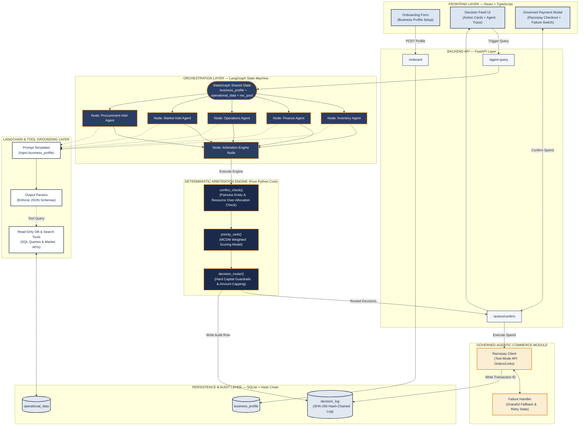

# Master Project Blueprint & Defense Architecture
## Multi-Agent Business Decision Intelligence & Governed Agentic Commerce Platform

---

### Executive Document Summary
This document serves as the **definitive research-grounded master blueprint** for our Capstone Project and its integrated Agentic Commerce module. It establishes:
1. **Literature Survey & Gap Matrix**: Systematic analysis of 12 peer-reviewed papers (2025–2026) across multi-agent orchestration, financial AI, digital twins, and domain adaptation.
2. **Extended Agent Architecture**: Expands core domain intelligence to include **Market Intelligence** and **Procurement Intelligence** alongside Inventory, Finance, and Operations.
3. **Deterministic Arbitration Engine**: Mathematical multi-criteria decision making (MCDM) and capital guardrail routing.
4. **Governed Agentic Commerce (Razorpay Test Integration)**: Explainable, bounded, gated financial action execution with SHA-256 audit logging and graceful failure handling.
5. **Evaluation Rubric Strategy**: Direct mapping to score **"5 - Far Exceeds Expectation"** across all 5 evaluation criteria (Literature Survey, Problem Statement, System Design, Implementation/Results, Interim Report).
6. **Panel Review Task Division**: Concrete 3-member work allocation (**AryanT**, **Soham**, **Kohli**) for tomorrow's panel demonstration and code integration.

---

## 1. Literature Survey & Systematic Research Gap Matrix

A comprehensive literature synthesis was conducted across twelve key research papers. The table below documents each study, its contribution, its limitation, and how our project bridges the identified research gaps.

### 1.1 Comprehensive Literature Matrix (Papers 1–12)

| Ref | Study & Publication | Core Technical Contribution | Limitation / Open Research Gap | How Our System Bridges the Gap |
| :--- | :--- | :--- | :--- | :--- |
| **P1** | **Chen et al. (2026)**<br>*Well-log MAS (Elsevier)* | Role-based agent decomposition + tool-grounded hybrid physics/ML reasoning; human-in-the-loop cut error 47% $\rightarrow$ 17%. | Highly single-domain (petroleum well logging) with expert supervision; not generalized to multi-domain business operations. | Adapts role decomposition & read-only tool grounding across 5 business domains (Inventory, Finance, Ops, Market, Procurement). |
| **P2** | **Massoudi & Fuge (2025)**<br>*Agentic LLMs (ASME)* | Multi-agent graph framework out-performed 2-agent setup on coverage, but failed on exact numeric reasoning. | LLM reasoning alone is inherently unreliable for exact numeric/financial math over long context; arithmetic must sit outside LLM. | Enforces strict rule: LLMs generate zero numbers directly; all quantities originate from read-only SQL database tools. |
| **P3** | **Thakker (2026)**<br>*Cloud-Edge MAS (IEEE)* | RL-scheduled hierarchical orchestration; self-healing gives 99.7% completion under network failures. | Validates resilience patterns for cloud-edge infrastructure scheduling, but applied strictly to network traffic, not business decisions. | Borrows self-healing agent state isolation patterns into our LangGraph StateGraph orchestrator. |
| **P4** | **Pendyala et al. (2026)**<br>*AI Payment Orchestration (Springer)* | Identifies fraud, compliance, and routing as fragmented silos; solves with federated learning + blockchain audit. | Blockchain consensus overhead is unjustified at single-SME scale; compliance checks are rule-driven underneath RL routing, not human-approved per action. | Replaces public blockchain with a lightweight, local SHA-256 hash-chained log; introduces 1-click human-gated Razorpay payment execution. |
| **P5** | **Devi et al. (2026)**<br>*Big Data & Strategic DSS (IEEE)* | Empirically links analytics maturity to enterprise performance across retail, finance, and healthcare. | Confirms the "analytics-to-action gap": systems produce dashboards/reports, but lack mechanisms to convert insights into executable workflows. | Directly replaces chart-based dashboards with a visual **Action Card Feed** with single-tap execution buttons. |
| **P6** | **Khan et al. (2026)**<br>*Agile+TensorFlow DSS (IEEE)* | Delivery methodology for deploying AI-based Decision Support Systems in enterprises using Agile sprints. | Process guidance only; leaves technical multi-agent architecture, conflict resolution, and explainability completely unaddressed. | Provides a concrete, fully specified 5-layer system architecture with code-level schemas. |
| **P7** | **Hasan & Nguyen (2026)**<br>*Agentic AI + Digital Twins (Elsevier)* | Layered *perception $\rightarrow$ reasoning $\rightarrow$ decision $\rightarrow$ action $\rightarrow$ feedback* loop for power-grid balancing. | Assumes a continuous physical digital twin with IoT sensor streams—too heavy and impractical for digital/partially-digital SMEs. | Adapts the closed perception-action loop into a lightweight "Business Context State" built from onboarding profiles and database ledgers. |
| **P8** | **Santhosh et al. (2026)**<br>*BridgeRock AI, Financial MAS (IEEE)* | Multi-agent (Data, Insight, Thesis) + RAG architecture for institutional equity research with evidence pointers. | Output delivered as a conversational chatbot for institutional financial analysts; RAG optimized for unstructured documents, not SQL tables. | Borrows evidence traceability, but replaces document RAG with structured database SQL queries and replaces chat with decision cards. |
| **P9** | **Ma et al. (2026)**<br>*Lightweight Edge MAS (Elsevier)* | Hierarchical edge/cloud tiers; uses game-theoretic (Nash equilibrium) consensus to cut communication overhead. | Game-theoretic consensus is mathematically complex and opaque (black-box) to a non-technical business owner; lacks explainability. | Replaces opaque game-theoretic voting with a transparent, inspectable Multi-Criteria Decision Making (MCDM) weighted score. |
| **P10**| **Electronic Markets (2026)**<br>*MAAI Conceptual Framework* | 5-layer framework (*Foundation Model, Perception, Orchestration, Workflow, Interface*). | Explicitly identifies Dynamic Orchestration (Layer 3) and the User Interaction Layer (Layer 5) as the least studied areas in literature. | Confirms our two core contributions (deterministic conflict arbitration + non-chat decision UI) hit real academic gaps. |
| **P11**| **Kirchdorfer et al. (2025)**<br>*AgentSimulator (Springer)* | Discovers MAS workflows from event logs; demonstrates orchestration vs autonomy must be selected per process. | Coordination rules are discovered post-hoc from historical event logs, rather than arbitrated in real-time for live competing agent outputs. | Validates real-time arbitration of contending agent outputs as an unaddressed operational requirement. |
| **P12**| **Yang et al. (2026)**<br>*SimLoRA (Springer)* | Demonstrates standard LoRA under-learns sparse personalized signals; proposes attention-weighted LoRA + RLHF. | Highlights that domain fine-tuning requires substantial annotation and engineering; unneeded if structured context + tools yield high precision. | Guides our design choice: keep general-purpose LLM + read-only tool grounding as core baseline; treat LoRA fine-tuning as a gated stretch goal. |

---

### 1.2 Research & Gap Analysis for New Extended Intelligence Domains

To address holistic business operations, we extend our agent architecture beyond internal logistics to include **Market Intelligence** and **Procurement Intelligence**.

#### A. Market Intelligence Agent
- **Domain Scope**: Analyzes external market demand shifts, competitor pricing signals, product trend velocity, and macroeconomic consumer sentiment.
- **Existing Solutions & Gaps**: Current solutions (e.g., Google Trends scrapers, PriceSpider, SEMrush) operate as isolated marketing tools. They tell a business owner *what* is trending outside, but have zero visibility into internal inventory levels or cash reserves. Conversely, internal ERPs are completely blind to external market drops or demand spikes.
- **Our Proposed Approach**: The **Market Intelligence Agent** uses external search/pricing tools to monitor competitor prices and trend shifts. It generates a structured `MarketOpportunity` recommendation (e.g. *"Demand for Product Y increased 35% across competitors; increase retail price by 8% or scale stock"*). This recommendation is fed into the central Arbitration Engine to evaluate whether cash reserves permit capitalizing on the trend.

#### B. Procurement Intelligence Agent
- **Domain Scope**: Analyzes supplier lead-time volatility, raw material commodity index pricing, vendor reliability scores, and minimum order quantity (MOQ) volume discounts.
- **Existing Solutions & Gaps**: Standard inventory reorder formulas (e.g., EOQ) assume static supplier lead times and fixed unit costs. In reality, supplier lead times fluctuate wildly, and vendors offer tiered volume discounts that require capital trade-offs.
- **Our Proposed Approach**: The **Procurement Intelligence Agent** monitors supplier performance logs and raw material market rates. Instead of simply reordering stock when depleted, it evaluates vendor risk and volume discount thresholds (e.g. *"Supplier B lead time degraded to 14 days; switch to Supplier A at 3% higher unit cost to prevent stockout"*).

---

## 2. Problem Statement & Research Questions

### 2.1 Problem Statement
> **Resource-constrained SMEs generate fragmented operational data across inventory, sales, finance, market trends, and procurement, but lack an integrated decision-support system capable of converting this data into prioritized, explainable, and executable actions. Existing multi-agent systems operate in domain silos, produce unverified numeric outputs via LLM reasoning, resolve recommendation conflicts through opaque algorithms (or leave them to owner manual labor), and present outputs through conversational chat interfaces that induce alert fatigue.**

### 2.2 Formal Research Questions (RQs)
- **RQ1 (Tool-Grounded Domain Multi-Agent Reasoning)**: *How can specialized domain agents (Inventory, Finance, Operations, Market, Procurement) be grounded in structured database context and external tools to guarantee numeric precision without hallucination?*
- **RQ2 (Deterministic Conflict Arbitration)**: *How can conflicting recommendations from independent agents competing for finite liquid capital be systematically detected and arbitrated using a transparent, inspectable multi-criteria model?*
- **RQ3 (Non-Conversational Decision UI)**: *How can complex multi-agent reasoning and arbitration traces be transformed into a prioritized visual decision interface without resorting to conversational free text?*
- **RQ4 (Governed Agentic Commerce & Auditability)**: *How can financial execution guardrails (amount caps, human gating) and tamper-evident cryptographic audit logging be integrated into live payment gateway workflows (Razorpay)?*

---

## 3. System Architecture & Technical Specifications



---

### 3.1 Mathematical Specification of the Arbitration Engine

The Arbitration Engine runs entirely in **pure, unit-testable Python** without LLM nondeterminism.

#### Algorithm 1: Resource Conflict Detection (`conflict_check`)
Given a set of $N$ agent recommendations $R = \{r_1, r_2, \dots, r_N\}$, available cash $C_{\text{avail}}$, and minimum cash reserve $C_{\text{mcr}}$:

$$\text{Liquid Buffer } B = C_{\text{avail}} - C_{\text{mcr}}$$

A resource conflict is flagged if:

$$\sum_{i=1}^{N} \text{estimated\_cost}(r_i) > B$$

Additionally, an entity conflict is flagged for any pair $(r_i, r_j)$ where $\text{entity\_id}(r_i) = \text{entity\_id}(r_j)$ and $\text{action\_type}(r_i) \neq \text{action\_type}(r_j)$.

#### Algorithm 2: Multi-Criteria Decision Making Score (`priority_rank`)
Each recommendation $r_i$ is evaluated against 4 normalized criteria ($0.0 - 1.0$):

$$\text{Score}(r_i) = w_1 \cdot S_{\text{rev}}(r_i) + w_2 \cdot S_{\text{urg}}(r_i) + w_3 \cdot S_{\text{cash}}(r_i) + w_4 \cdot S_{\text{conf}}(r_i)$$

Where:
- $S_{\text{rev}}$: Revenue at risk / expected net gain ratio ($0.0 - 1.0$).
- $S_{\text{urg}}$: Urgency score derived from days until stockout or bill deadline:
  $$S_{\text{urg}} = \max\left(0, 1.0 - \frac{\text{Days Remaining}}{14}\right)$$
- $S_{\text{cash}}$: Cash buffer impact ratio:
  $$S_{\text{cash}} = 1.0 - \frac{\text{estimated\_cost}(r_i)}{B}$$
- $S_{\text{conf}}$: Agent confidence score ($0.0 - 1.0$).
- Weights: $w_1 = 0.40, w_2 = 0.30, w_3 = 0.20, w_4 = 0.10$ ($\sum w_k = 1.0$).

#### Algorithm 3: Capital Guardrail Routing & Amount Capping (`decision_router`)
If $r_i$ is ranked #1 but $\text{estimated\_cost}(r_i) > B$, the router **automatically caps the approved amount**:

$$\text{approved\_amount}(r_i) = B$$

The recommendation is converted to a partial order with an explicit note: *"Quantity capped to INR $B$ to preserve required cash reserve $C_{\text{mcr}}$."*

---

### 3.2 Governed Agentic Commerce & Razorpay Test Integration

For actions requiring monetary transactions (e.g. B2B inventory restock), the platform routes through the **Governed Agentic Commerce Module**:

1. **Explainable Payment Note**: The Razorpay Order payload includes AI metadata notes:
   ```json
   {
     "amount": 2000000,
     "currency": "INR",
     "receipt": "DEC-2026-901",
     "notes": {
       "decision_id": "DEC-2026-901",
       "bounded_by": "Finance_Agent_Cash_Guardrail",
       "explanation": "Restock SKU-PROD-A capped at INR 20,000 to preserve cash reserve."
     }
   }
   ```
2. **Gated Approval**: Payments are **never executed autonomously**. The UI presents a clear confirmation modal showing the capped amount, reasoning trace, and a single-click `[Approve & Execute via Razorpay]` button.
3. **SHA-256 Cryptographic Audit Log**:
   $$\text{Hash}_k = \text{SHA-256}(\text{Hash}_{k-1} \parallel \text{Timestamp}_k \parallel \text{DecisionID}_k \parallel \text{RazorpayOrderID}_k)$$
4. **Graceful Failure Handling**: If the Razorpay test API fails (e.g. simulated network timeout or invalid key), the module catches the exception, updates the decision status to `"HELD_IN_AUDIT_STATE"`, logs the failure payload, and displays a user-friendly recovery toast rather than crashing.

---

## 4. Evaluation Rubric Strategy (Scoring 5/5 "Far Exceeds Expectation")

Tomorrow's evaluation panel will assess the project across 5 parameters. Below is our exact strategy to score **5/5** in every category.

```
┌────────────────────────────────────────────────────────────────────────────────────────┐
│                        FACULTY EVALUATION RUBRIC STRATEGY                              │
├──────────────────────────┬─────────────────────────────────────────────────────────────┤
│ Rubric Parameter         │ How We Achieve "5 - Far Exceeds Expectation"                │
├──────────────────────────┼─────────────────────────────────────────────────────────────┤
│ A. Literature Survey     │ • Present a systematic 12-paper literature matrix (2025–26).│
│    / Market Survey (5)   │ • Explicitly map 5 cross-paper gaps to system modules.      │
│                          │ • Include Market & Procurement Intel competitive survey.    │
├──────────────────────────┼─────────────────────────────────────────────────────────────┤
│ B. Problem Statement (5) │ • Present crisp, formal Problem Statement & 4 RQs.          │
│                          │ • Highlight the "₹40k cash vs ₹65k demand" MSME scenario.   │
├──────────────────────────┼─────────────────────────────────────────────────────────────┤
│ C. System Level          │ • Show comprehensive 5-layer Mermaid Architecture Diagram.  │
│    Representation (5)    │ • State exact algorithms: MCDM weighted scoring & SHA-256. │
│                          │ • Display complete JSON contracts for all agent interfaces. │
├──────────────────────────┼─────────────────────────────────────────────────────────────┤
│ D. Implementation        │ • Show working >40% MVP prototype live in the panel.        │
│    / Results (5)         │ • Demonstrate end-to-end execution: Seed Data -> LangGraph  │
│                          │   Agents -> Conflict Arbitration -> Action Cards -> Razorpay│
│                          │   Test Mode Order -> Hash Audit Log.                         │
│                          │ • Live failure-handling simulation toggle on UI.           │
├──────────────────────────┼─────────────────────────────────────────────────────────────┤
│ E. Interim Report (5)    │ • Submit comprehensive Master Blueprint document.           │
│                          │ • Outline full 12-week roadmap & Phase 4 stretch goals.     │
└──────────────────────────┴─────────────────────────────────────────────────────────────┘
```

---

## 5. Team Work Division for Tomorrow's Panel & MVP Demonstration

To ensure AryanT can focus heavily on the **Hackathon (Agentic Commerce Razorpay track)** while Soham and Kohli build the backend engine and frontend UI, the workload for tonight and tomorrow's panel is divided as follows:

```
                                  TEAM WORK DIVISION
  ┌──────────────────────────────┬──────────────────────────────┬──────────────────────────────┐
  │   ARYANT (Lead & Commerce)   │   SOHAM (Engine & Data)      │   KOHLI (Frontend & UI)      │
  ├──────────────────────────────┼──────────────────────────────┼──────────────────────────────┤
  │ • Razorpay Test-Mode Client  │ • SQLite DB & Seed Generator │ • React + TypeScript UI      │
  │ • Governed Payment API       │ • Inventory & Finance Agents │ • Onboarding Form Component  │
  │ • Failure Handler Fallback   │ • Arbitration Engine (MCDM)  │ • Priority Action Cards Feed │
  │ • SHA-256 Audit Log Engine   │ • LangGraph State Machine    │ • Governed Checkout Modal    │
  │ • Hackathon Submission Brief │ • Synthetic Conflict Scenario│ • Failure Simulation Switch  │
  └──────────────────────────────┴──────────────────────────────┴──────────────────────────────┘
```

### Detailed Deliverable Responsibilities

#### 1. AryanT (Focus: Governed Agentic Commerce & Backend Integration)
- **Role & Scope**: Owns the payment execution, audit logging, and Hackathon alignment.
- **Concrete Modules**:
  - `src/payment/razorpay_client.py`: Integrates Razorpay test-mode API (`rzp_test_...`) to generate orders with embedded AI explanation notes.
  - `src/core/audit.py`: Implements SHA-256 hash-chain logging (`decision_log`).
  - `src/api/main.py`: Writes FastAPI `/action/confirm` endpoint connecting approval UI to Razorpay and audit logging.
  - **Graceful Failure Case**: Implements try/except fallback that logs `"HELD_IN_AUDIT_STATE"` if payment API fails.
- **Hackathon Alignment**: Ensures the Razorpay test integration directly fulfills the Hackathon's "explainable, bounded, gated, audited, failure-handled" mandate.

#### 2. Soham (Focus: Data Foundation, Domain Agents & Arbitration Engine)
- **Role & Scope**: Owns the backend data engine, domain agents, and mathematical conflict arbitration.
- **Concrete Modules**:
  - `src/core/database.py`: SQLAlchemy schemas for `business_profile`, `operational_data`, `decision_log`.
  - `src/seed_data.py`: Seeds synthetic store data generating a realistic conflict scenario (₹40k cash, ₹25k restock needed, ₹15k tax due).
  - `src/agents/inventory_agent.py` & `finance_agent.py`: Domain agents with read-only SQL tool calls.
  - `src/core/arbitration.py`: Pure Python implementation of `conflict_check()`, `priority_rank()` (MCDM formula), and `decision_router()` (capping restock at ₹20k).
  - `src/api/main.py`: FastAPI `/onboard` and `/agent-query` endpoints.

#### 3. Kohli (Focus: React Frontend, Action Cards & Interactive Demo)
- **Role & Scope**: Owns the user interface, action card rendering, and live presentation controls.
- **Concrete Modules**:
  - `frontend/src/components/OnboardingForm.tsx`: Form for business category, revenue band, and cash reserve input.
  - `frontend/src/components/ActionCardFeed.tsx`: Action card feed displaying top prioritized decisions with "Why?" evidence accordions and agent stances.
  - `frontend/src/components/GovernedPaymentModal.tsx`: Modal appearing on `[Approve & Execute]` click showing capped amount (₹20k), AI reasoning trace, and Razorpay test checkout button.
  - **Failure Switch**: Includes a toggle button on the UI (`[Simulate Payment API Failure]`) to demonstrate graceful error handling to faculty and judges.

---

### 6. Overall Long-Term Master Project Roadmap

Beyond tomorrow's MVP demonstration, the complete 12-week capstone roadmap is structured as follows:

```
WEEKS 1–2: Foundation & Data Layer (Completed in MVP)
├── SQLite Schema & SQLAlchemy models
├── Synthetic MSME data generator
└── Onboarding API & Business Profile Context

WEEKS 3–4: Core Agent & Arbitration Engine (Completed in MVP)
├── Inventory, Finance, & Operations agents with read-only SQL tool grounding
├── Deterministic Python Arbitration Engine (conflict_check, priority_rank MCDM, decision_router)
└── Action Card Feed UI + SHA-256 Audit Log

WEEKS 5–7: Extended Domain Intelligence (Phase 2)
├── Market Intelligence Agent (Competitor pricing & trend velocity tools)
├── Procurement Intelligence Agent (Supplier lead-time volatility & volume discount tools)
└── Expanded 5-agent LangGraph fan-out / fan-in state machine

WEEKS 8–9: Governed Agentic Commerce & Multi-Channel (Phase 3)
├── Full Razorpay B2B Payouts & Supplier Settlement Integration
├── Unstructured Input Integration (Customer WhatsApp agent in Hindi/English)
└── Advanced Decision Workspace UI with historical trend analytics

WEEKS 10–12: Evaluation, Fine-Tuning & Final Defense (Phase 4)
├── Benchmark evaluation across 50+ stress-test scenarios
├── Gated evaluation of SimLoRA fine-tuning vs baseline general-purpose LLM
└── Final Viva Defense & Final Capstone Report submission
```

---
